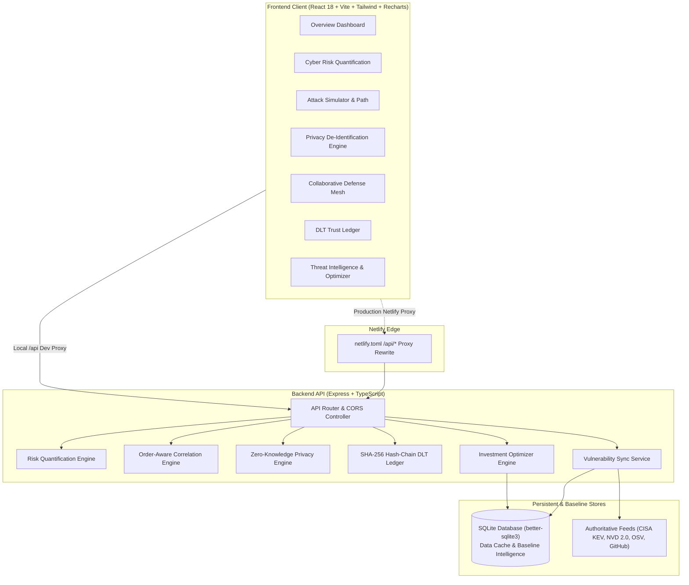
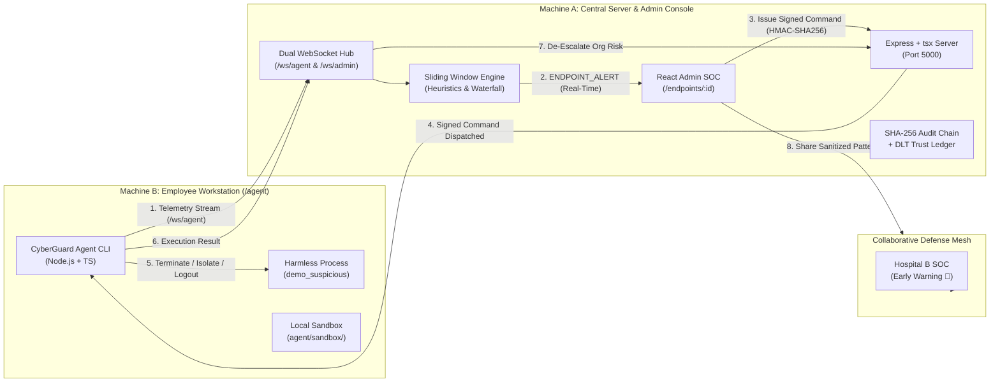

# CYBERGUARD GRID 🛡️⚡

**AI-Powered Cyber Risk Quantification, Attack Simulation & Collaborative Defense Platform**  
*SIH Prototype — All attacks and SOC telemetry are strictly SIMULATED. No IoT devices are targeted and no real exploit actions are performed.*

---

## 📋 Table of Contents
1. [Overview](#-overview)
2. [Key Capabilities](#-key-capabilities)
3. [Architecture](#-architecture)
4. [Tech Stack](#-tech-stack)
5. [Quick Start (Local Run)](#-quick-start-local-run)
6. [Cloud Deployment](#-cloud-deployment)
7. [Demo Walkthrough](#-demo-walkthrough)
8. [Prototype Limitations & Security Notice](#-prototype-limitations--security-notice)

---

## 🌐 Overview

**CyberGuard Grid** is an enterprise-grade cyber risk quantification and collaborative defense mesh designed to democratize threat intelligence across diverse industry participants (e.g., **Demo Bank [Financial]**, **City Hospital [Healthcare]**, and **State University [Higher Ed]**).

Traditional SIEM/SOC platforms silo telemetry within individual enterprise boundaries. CyberGuard Grid demonstrates how institutions can:
1. Objectively quantify continuous risk exposure using transparent weighted formulas.
2. Simulate realistic attack paths to identify and remediate the weakest link.
3. Automatically sanitize private organizational incidents into zero-knowledge threat behavior patterns.
4. Broadcast anonymized signatures over a peer-to-peer defense mesh to trigger early warnings for peer organizations before an attack cascades.
5. Record immutable threat proofs onto an auditable, SHA-256 cryptographic DLT ledger.

---

## ⚡ Key Capabilities

- **Transparent Cyber Risk Quantification**: Live weighted mathematical model (`Authentication: 25%`, `Network: 20%`, `Data Sensitivity: 20%`, `Vulnerabilities: 20%`, `Controls: 10%`, `Incidents: 5%`) with interactive sliders, dynamic weight recalculation, and waterfall contributor attribution.
- **Deterministic Attack Simulator & Attack Path**: Step-by-step adversary kill-chain playback (Phishing, Session Hijacking, Cloud IAM theft, Ransomware, DMZ exploit), pinpointing the critical single point of failure with live "What if I fix this?" counterfactual remediation.
- **Collaborative Defense Mesh Network**: Multi-tenant mesh correlating threat behavioral sequences across organizations using order-aware pattern matching and automated early warning broadcast.
- **Zero-Knowledge Privacy Engine**: Cryptographically masks PII, internal subnets, device serials, and employee accounts, yielding sanitized, shareable behavior signatures.
- **Cryptographic Hash-Chain Trust Ledger**: Built using Node `crypto` SHA-256 hash chains `(blockNumber + threatId + reporterOrg + patternHash + validators + timestamp + previousHash)`, offering complete cryptographic integrity verification and tamper detection.
- **Live Vulnerability Intelligence Hub**: Automated multi-source ingestion from **CISA KEV (Known Exploited Vulnerabilities)**, **NIST NVD 2.0**, **OSV.dev**, and **GitHub Security Advisories** with SQLite baseline caching.
- **Investment Optimization Engine**: Budget-constrained security investment optimizer maximizing risk reduction per capital expenditure.
- **Executive SOC Reporting**: Print and PDF-ready governance summaries with compliance breakdowns, threat posture radar charts, and prioritized remediation matrices.

---

## 🏗️ Architecture



---

## 💻 Tech Stack

- **Frontend**: React 18, Vite, TypeScript, Tailwind CSS, Recharts, Lucide Icons, React Router v6.
- **Backend**: Express.js, TypeScript (`tsx`), Node.js `crypto`, CORS, dotenv.
- **Database**: SQLite via `better-sqlite3` with automated baseline seeding from `demoBaselineData.ts` (MySQL optional).
- **Tooling**: Node.js v18+, NPM workspaces, native PowerShell / bash execution scripts.

---

## 🚀 Quick Start (Local Run)

### Prerequisites
- Node.js (v18.0.0 or higher recommended)
- npm (v9.0.0 or higher)

### 1-Command Startup (Recommended)
From the project root:
```bash
node run.js
```
This automatically verifies dependencies and starts both the **Backend** (`http://localhost:5000`) and the **Frontend** (`http://localhost:5173`).

### Alternative: Direct NPM Scripts
```bash
# 1. Install all dependencies
npm run install:all

# 2. Start servers concurrently
npm start
```

Or run each in dedicated terminals:
```bash
# Terminal 1: Backend
cd backend
npm run dev

# Terminal 2: Frontend
cd frontend
npm run dev
```

### URLs
- **Web Interface**: [http://localhost:5173](http://localhost:5173)
- **API Health Check**: [http://localhost:5000/api/health](http://localhost:5000/api/health)
- **Backend Test Suite**: `npm test` inside `backend/` (15 passing tests across 6 suites)

---

## 🔒 Security, Hardening & API Protection

CyberGuard Grid implements comprehensive defense-in-depth API protections:
1. **Sliding-Window Rate Limiting**: In-memory rate limiting middleware in [`backend/src/middleware/rateLimiter.ts`](file:///c:/Users/krish/OneDrive/Desktop/git/sih%204/sih3/sih%206/backend/src/middleware/rateLimiter.ts):
   - **General API Limiter**: 250 requests/min per IP with standard `X-RateLimit-*` and `Retry-After` headers.
   - **Strict Mutation Limiter**: 40 requests/min for state-modifying endpoints (`/api/ledger/tamper`, `/api/ledger/add`, `/api/demo/reset`, `/api/sync/run`).
2. **Schema-Driven Request Validation**: Declarative payload validator in [`backend/src/middleware/validator.ts`](file:///c:/Users/krish/OneDrive/Desktop/git/sih%204/sih3/sih%206/backend/src/middleware/validator.ts) enforcing strict type checks, length constraints, and numerical bounds (`0 <= score <= 100`, `1 <= step <= 4`).
3. **CORS Isolation**: Restricts origin access based on `ALLOWED_ORIGIN` environment configuration with credentials verification.
4. **Environment Safety**: Dedicated `backend/.env.example` template with strict `.gitignore` rules ensuring production secrets and credentials are never checked into version control.

---

## ☁️ Cloud Deployment

### 1. Frontend on Netlify
The frontend repository includes pre-configured [`netlify.toml`](file:///c:/Users/krish/OneDrive/Desktop/git/sih%204/sih3/sih%206/netlify.toml) settings:
1. Connect repository to Netlify.
2. Set **Base directory** to `frontend`.
3. Set **Build command** to `npm run build`.
4. Set **Publish directory** to `frontend/dist`.
5. In Netlify environment variables:
   - `BACKEND_URL`: URL of your deployed backend (e.g. `https://cyberguard-backend.onrender.com`).
   The proxy rule will automatically forward `/api/*` to the backend without CORS or cookie issues.

### 2. Backend on Render or Railway
The repository includes a ready-to-deploy [`render.yaml`](file:///c:/Users/krish/OneDrive/Desktop/git/sih%204/sih3/sih%206/render.yaml):
1. Create a new Web Service on Render / Railway pointing to the `backend` directory.
2. **Build command**: `npm install && npm run build`
3. **Start command**: `npm start`
4. Set environment variables:
   - `PORT`: `5000`
   - `NODE_ENV`: `production`
   - `ALLOWED_ORIGIN`: Your Netlify frontend domain (e.g. `https://cyberguard-grid.netlify.app`)

---

## 🖥️ Module 8: Endpoint Agent & Remote Remediation

Based on institutional security requirements:
> *"If a user's computer is attacked, the admin should get notified in their admin login and be able to fix things on that user's system remotely."*

Module 8 introduces a consent-based, cryptographic endpoint security agent (`/agent`), real-time dual-channel WebSockets, sliding-window threat heuristics, and an administrative remote remediation action center.



---

### 🛡️ Safety Guarantees & Whitelist Architecture (Mandatory Lab Prototype Design)

CyberGuard Grid strictly complies with ethical and secure prototype engineering standards:

1. **Explicit Consent & Full Visibility**: The agent displays an interactive terminal banner upon start (`CyberGuard Agent running, monitored by <Org>`), logs all activities openly, can be terminated by the workstation user with `Ctrl+C`, and **never** conceals itself or persists across system reboots.
2. **Whitelist-Only Command Execution**: The agent executes **strictly** the 7 whitelisted administrative actions below with strict schema validation. Arbitrary shell commands, external PIDs, and unverified executables are rejected and logged:
   - `kill_process`: **Only** terminates processes spawned and tracked by the agent itself (specifically the harmless idle test process `demo_suspicious`). Arbitrary OS PIDs are rejected.
   - `force_logout`: Invalidates the user's active session tokens and clears local workstation authorization state.
   - `isolate_device`: Sets a simulated network isolation flag in telemetry without altering host network adapters.
   - `release_isolation`: Reverses the simulated isolation flag.
   - `quarantine_file`: Moves suspicious test files inside `agent/sandbox/` into `agent/sandbox/quarantine/`. Path traversal (`..`, absolute paths) is blocked by boundary containment checks.
   - `reset_credentials`: Flags user credentials as expired in the database, requiring the user to set a new password on their next login attempt.
   - `collect_diagnostics`: Returns the agent's recent event buffer only.
3. **Cryptographic HMAC-SHA256 Authentication**: Every administrative command carries `deviceId`, `commandId`, `action`, `params`, `issuedBy`, `issuedAt`, `expiresAt` (60-second TTL), and a unique anti-replay `nonce`. Commands are signed with the per-device secret (`command_secret`). The agent validates signature, TTL, and nonce freshness before executing.
4. **Tenant Isolation**: Only authenticated admins of the **same organization** can issue commands to that organization's workstations. Cross-tenant command execution returns HTTP 403 and writes an immutable audit record.
5. **Immutable SHA-256 Audit Log**: Every authentication, threat alert, command issuance, execution result, and tamper attempt is appended to a cryptographic hash-chain (`prev_hash` pointer) with automated anchoring to the DLT Trust Ledger.
6. **Harmless Attack Simulator**: The attack generator emits deterministic synthetic events and launches an idle loop process (`demo_suspicious`). It runs strictly with `SIMULATION ONLY` tags.

---

### 🌐 Multi-Machine LAN / Wi-Fi Setup Guide

You can run CyberGuard Grid across **two separate laptops** on the same local Wi-Fi / LAN network:

#### 1. Machine A (SOC Command Center & Backend Server)
1. Find Machine A's local IP address:
   - Windows: Run `ipconfig` (e.g. `192.168.1.105`)
   - macOS / Linux: Run `ifconfig` or `ip a`
2. Start the backend server on Machine A:
   ```bash
   cd backend
   npm run dev
   ```
   *(Listens on port 5000 and accepts WebSocket connections on `/ws/agent` and `/ws/admin`)*.
3. Start the frontend console on Machine A:
   ```bash
   cd frontend
   npm run dev -- --host
   ```
4. Log into the SOC Command Center as Bank A Admin:
   - URL: `http://localhost:5173` (or `http://192.168.1.105:5173`)
   - Email: `admin@banka.com` | Password: `AdminPass123!`
5. Navigate to **Endpoints** (`/endpoints`) and click **Enroll Workstation** to generate a one-time enrollment authorization code (e.g. `CG-A1B2-C3D4`).

#### 2. Machine B (Employee Workstation running Agent CLI)
1. On Machine B, ensure Node.js 18+ is installed.
2. In `agent/config.json` (or via CLI argument), configure Machine A's LAN IP:
   ```json
   {
     "backendUrl": "http://192.168.1.105:5000",
     "wsUrl": "ws://192.168.1.105:5000"
   }
   ```
3. Run the one-time enrollment handshake:
   ```bash
   cd agent
   npm run enroll
   ```
   Enter the code generated from Machine A (e.g. `CG-A1B2-C3D4`). The agent will receive its unique `deviceId`, per-device `token`, and `commandSecret`.
4. Start the agent client:
   ```bash
   npm run dev
   ```
   The terminal will display the consent banner:
   ```
   ============================================================
   🛡️  CYBERGUARD ENDPOINT SECURITY AGENT — ACTIVE MONITORING
   Monitored Workstation: ALICE-LAPTOP-W11 (DEV-BANK-01)
   Institutional Organization: org-1 (Bank A)
   Consent Mode: VISIBLE • NON-STEALTH • WHITELIST ONLY
   Press Ctrl+C to disconnect and stop agent monitoring at any time.
   ============================================================
   ```
5. Trigger the harmless attack simulation on Machine B:
   ```bash
   npm run simulate
   ```
   Machine B will spawn harmless process `demo_suspicious` and emit 20 deterministic events. Within 1 second, Machine A's admin console will trigger an `ENDPOINT_ALERT` toast and escalate risk to Critical!

---

### 🎬 Scripted Demo Walkthrough (End-to-End Story)

1. **One-Click Scripted Demo**:
   - In the SOC Console, navigate to **Endpoints** and click **"Run Endpoint Demo"** (or use the floating Demo Mode controller).
2. **Step 1: Infiltration & Threat Detection**:
   - Multi-stage attack injects rapid brute-force logins, anomalous geolocation velocity, privilege escalation (`demo_suspicious`), and high-volume egress.
   - Sliding-window heuristic engine evaluates rules (`RULE-AUTH-01`, `RULE-PROC-03`, `RULE-DATA-04`), confidence hits 94%, and device transitions to **Compromised**.
   - Admin receives an instant notification toast: *"🚨 THREAT DETECTED ON ALICE-LAPTOP-W11"*.
3. **Step 2: Admin Deep Dive & Explainability**:
   - Clicking the alert navigates to **Device Detail** (`/endpoints/DEV-BANK-01`).
   - Admin reviews the **Explainability Risk Waterfall** breaking down risk across Authentication (+25), Identity (+18), Endpoint (+26), and Data Egress (+20).
4. **Step 3: Remote Remediation & Containment**:
   - Admin clicks **"Kill Suspicious Process"** and **"Force Session Logout"**.
   - Backend cryptographically signs the commands with HMAC-SHA256 and streams them over WebSocket.
   - The agent terminates `demo_suspicious` and clears tokens.
   - Device status updates live to **Remediated**. Organization risk score de-escalates from **88 down to 24** across all SOC visualizers.
5. **Step 4: User Notice & Forced Password Reset**:
   - On the employee's **My Device** page (`/my-device`), Alice sees the remediation record: *"Admin ran kill_process and force_logout on your workstation"*.
   - If credentials were reset, Alice is prompted with the mandatory password reset form.
6. **Step 5: Collaborative Defense & Peer Early Warning**:
   - Admin clicks **"Share Sanitized Pattern"**.
   - PrivacyEngine cryptographically scrubs Alice's email, IP, hostname, and paths.
   - Abstract pattern `TH-8821` is anchored into the DLT Ledger (Block #10422).
   - Peer institution **Hospital B** correlates the pattern with 92% similarity and receives an **Early Warning** notification before the adversary can pivot!
7. **Step 6: Cryptographic Audit Verification**:
   - Navigate to **Audit Log** (`/audit-log`).
   - Click **"Verify Hash-Chain"** to confirm SHA-256 integrity across all actions.
   - Click **"Tamper Record (Demo)"** to witness instant cryptographic detection of modification!

---

## 🎯 Demo Walkthrough

1. **Overview Dashboard**: Inspect Demo Bank's current composite cyber risk score (84 / Critical), Circular HUD Gauge, Security Posture Radar (NIST CSF & MITRE aligned), and recent SOC telemetry events.
2. **Cyber Risk Quantification**: Adjust dynamic formula weights live (Authentication, Network, Vulnerabilities) and observe the Factor Waterfall chart recalculating risk attribution.
3. **Attack Simulator & Path**: Select **Phishing → Account Compromise**, run the step-by-step playback, observe the pulsing `⚡ WEAKEST LINK (CHOKEPOINT)` badge, and toggle "What if I fix this?" counterfactual remediation showing instant risk drop.
4. **Threat Detection**: View live SOC telemetry events and simulate an active privilege escalation event.
5. **Response Center**: Execute recommended remediation playbooks with quantifiable score reduction metrics and `⚡ QUICK WIN` badges.
6. **Privacy Engine**: Review the side-by-side "Shared vs. NOT Shared" privacy matrix, demonstrating how PII, internal IPs, and credentials are obfuscated into zero-knowledge threat behavior signatures (`TH-7821`).
7. **Collaborative Network**: Broadcast the sanitized pattern across the peer mesh; observe Order-Aware LCS sequence matching trigger an **Early Warning** for City Hospital (92% match) and FinTech Corp (85% match).
8. **DLT Trust Ledger**: Inspect the SHA-256 sequential block hash chain, simulate malicious tampering to witness immediate broken chain detection, and advance blocks through the multi-tenant consensus validator workflow.
9. **Executive Reports**: Generate executive-grade security reports and trigger "Print / Export PDF" with `@media print` styling that automatically strips navigation and buttons.

---

## 🔒 Prototype Limitations & Security Notice

### 🔑 Module 8 Demo Credentials (Prototype-Only)

> [!NOTE]
> All credentials below are provided strictly for SIH prototype evaluation and testing of role-based access control (RBAC), multi-tenancy, and remote remediation. **Do not use in production.**

| Organization | Role | Email | Password | Assigned Endpoint Device |
| :--- | :--- | :--- | :--- | :--- |
| **Bank A** (`org-1`) | **SOC Admin** | `admin@banka.com` | `AdminPass123!` | *Full Org Console Access* |
| **Bank A** (`org-1`) | User | `alice@banka.com` | `UserPass123!` | `DEV-BANK-01` (`ALICE-LAPTOP-W11`) |
| **Bank A** (`org-1`) | User | `bob@banka.com` | `UserPass123!` | `DEV-BANK-02` (`BOB-FIN-WS02`) |
| **Hospital B** (`org-2`) | **SOC Admin** | `admin@hospitalb.org` | `AdminPass123!` | *Full Org Console Access* |
| **Hospital B** (`org-2`) | User | `clara@hospitalb.org` | `UserPass123!` | `DEV-HOSP-01` (`CLARA-MED-TABLET`) |
| **Hospital B** (`org-2`) | User | `david@hospitalb.org` | `UserPass123!` | `DEV-HOSP-02` (`NURSE-STATION-04`) |
| **University C** (`org-3`) | **SOC Admin** | `admin@univc.edu` | `AdminPass123!` | *Full Org Console Access* |
| **University C** (`org-3`) | User | `emma@univc.edu` | `UserPass123!` | `DEV-UNIV-01` (`EMMA-RESEARCH-LAB`) |
| **University C** (`org-3`) | User | `frank@univc.edu` | `UserPass123!` | `DEV-UNIV-02` (`FRANK-ENG-DESK`) |

---

> **IMPORTANT**: This application is a technology demonstration prototype developed for Smart India Hackathon (SIH).
> 
> 1. **Simulation Only**: All simulated attacks, IP addresses, log telemetry, and threat actor indicators are synthetic. No network penetration testing, credential harvesting, or exploitation of live endpoints is ever performed.
> 2. **Prototype Authentication**: User authentication and multi-tenant access control are modeled for demonstration clarity without multi-factor session tokens. Production deployment requires an enterprise identity provider (OIDC/SAML, Keycloak, or Okta).
> 3. **Cryptographic Ledger**: The DLT ledger implements a verified local SHA-256 hash-chain consensus proof backed by SQLite. In enterprise production, this maps to distributed Hyperledger Fabric or Hedera Hashgraph consensus nodes.

