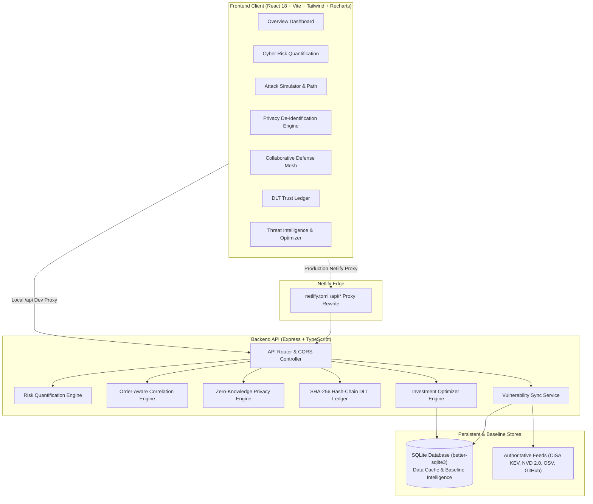

# CYBERGUARD GRID 🛡️⚡

**AI-Powered Cyber Risk Quantification, Attack Simulation & Collaborative Defense Platform**  
*SIH Prototype — All attacks and SOC telemetry are strictly SIMULATED. No IoT devices are targeted and no real exploit actions are performed.*

---

## 📋 Table of Contents
1. [Overview](#-overview)
2. [Key Capabilities](#-key-capabilities)
3. [Architecture](#-architecture)
4. [Tech Stack](#-tech-stack)
5. [Quick Start (Local Run)](#-quick-start-local-run)
6. [Cloud Deployment](#-cloud-deployment)
7. [Demo Walkthrough](#-demo-walkthrough)
8. [Prototype Limitations & Security Notice](#-prototype-limitations--security-notice)

---

## 🌐 Overview

**CyberGuard Grid** is an enterprise-grade cyber risk quantification and collaborative defense mesh designed to democratize threat intelligence across diverse industry participants (e.g., **Demo Bank [Financial]**, **City Hospital [Healthcare]**, and **State University [Higher Ed]**).

Traditional SIEM/SOC platforms silo telemetry within individual enterprise boundaries. CyberGuard Grid demonstrates how institutions can:
1. Objectively quantify continuous risk exposure using transparent weighted formulas.
2. Simulate realistic attack paths to identify and remediate the weakest link.
3. Automatically sanitize private organizational incidents into zero-knowledge threat behavior patterns.
4. Broadcast anonymized signatures over a peer-to-peer defense mesh to trigger early warnings for peer organizations before an attack cascades.
5. Record immutable threat proofs onto an auditable, SHA-256 cryptographic DLT ledger.

---

## ⚡ Key Capabilities

- **Transparent Cyber Risk Quantification**: Live weighted mathematical model (`Authentication: 25%`, `Network: 20%`, `Data Sensitivity: 20%`, `Vulnerabilities: 20%`, `Controls: 10%`, `Incidents: 5%`) with interactive sliders, dynamic weight recalculation, and waterfall contributor attribution.
- **Deterministic Attack Simulator & Attack Path**: Step-by-step adversary kill-chain playback (Phishing, Session Hijacking, Cloud IAM theft, Ransomware, DMZ exploit), pinpointing the critical single point of failure with live "What if I fix this?" counterfactual remediation.
- **Collaborative Defense Mesh Network**: Multi-tenant mesh correlating threat behavioral sequences across organizations using order-aware pattern matching and automated early warning broadcast.
- **Zero-Knowledge Privacy Engine**: Cryptographically masks PII, internal subnets, device serials, and employee accounts, yielding sanitized, shareable behavior signatures.
- **Cryptographic Hash-Chain Trust Ledger**: Built using Node `crypto` SHA-256 hash chains `(blockNumber + threatId + reporterOrg + patternHash + validators + timestamp + previousHash)`, offering complete cryptographic integrity verification and tamper detection.
- **Live Vulnerability Intelligence Hub**: Automated multi-source ingestion from **CISA KEV (Known Exploited Vulnerabilities)**, **NIST NVD 2.0**, **OSV.dev**, and **GitHub Security Advisories** with SQLite baseline caching.
- **Investment Optimization Engine**: Budget-constrained security investment optimizer maximizing risk reduction per capital expenditure.
- **Executive SOC Reporting**: Print and PDF-ready governance summaries with compliance breakdowns, threat posture radar charts, and prioritized remediation matrices.

---

## 🏗️ Architecture



---

## 💻 Tech Stack

- **Frontend**: React 18, Vite, TypeScript, Tailwind CSS, Recharts, Lucide Icons, React Router v6.
- **Backend**: Express.js, TypeScript (`tsx`), Node.js `crypto`, CORS, dotenv.
- **Database**: SQLite via `better-sqlite3` with automated baseline seeding from `demoBaselineData.ts` (MySQL optional).
- **Tooling**: Node.js v18+, NPM workspaces, native PowerShell / bash execution scripts.

---

## 🚀 Quick Start (Local Run)

### Prerequisites
- Node.js (v18.0.0 or higher recommended)
- npm (v9.0.0 or higher)

### 1-Command Startup (Recommended)
From the project root:
```bash
node run.js
```
This automatically verifies dependencies and starts both the **Backend** (`http://localhost:5000`) and the **Frontend** (`http://localhost:5173`).

### Alternative: Direct NPM Scripts
```bash
# 1. Install all dependencies
npm run install:all

# 2. Start servers concurrently
npm start
```

Or run each in dedicated terminals:
```bash
# Terminal 1: Backend
cd backend
npm run dev

# Terminal 2: Frontend
cd frontend
npm run dev
```

### URLs
- **Web Interface**: [http://localhost:5173](http://localhost:5173)
- **API Health Check**: [http://localhost:5000/api/health](http://localhost:5000/api/health)
- **Backend Test Suite**: `npm test` inside `backend/` (15 passing tests across 6 suites)

---

## 🔒 Security, Hardening & API Protection

CyberGuard Grid implements comprehensive defense-in-depth API protections:
1. **Sliding-Window Rate Limiting**: In-memory rate limiting middleware in [`backend/src/middleware/rateLimiter.ts`](file:///c:/Users/krish/OneDrive/Desktop/git/sih%204/sih3/sih%206/backend/src/middleware/rateLimiter.ts):
   - **General API Limiter**: 250 requests/min per IP with standard `X-RateLimit-*` and `Retry-After` headers.
   - **Strict Mutation Limiter**: 40 requests/min for state-modifying endpoints (`/api/ledger/tamper`, `/api/ledger/add`, `/api/demo/reset`, `/api/sync/run`).
2. **Schema-Driven Request Validation**: Declarative payload validator in [`backend/src/middleware/validator.ts`](file:///c:/Users/krish/OneDrive/Desktop/git/sih%204/sih3/sih%206/backend/src/middleware/validator.ts) enforcing strict type checks, length constraints, and numerical bounds (`0 <= score <= 100`, `1 <= step <= 4`).
3. **CORS Isolation**: Restricts origin access based on `ALLOWED_ORIGIN` environment configuration with credentials verification.
4. **Environment Safety**: Dedicated `backend/.env.example` template with strict `.gitignore` rules ensuring production secrets and credentials are never checked into version control.

---

## ☁️ Cloud Deployment

### 1. Frontend on Netlify
The frontend repository includes pre-configured [`netlify.toml`](file:///c:/Users/krish/OneDrive/Desktop/git/sih%204/sih3/sih%206/netlify.toml) settings:
1. Connect repository to Netlify.
2. Set **Base directory** to `frontend`.
3. Set **Build command** to `npm run build`.
4. Set **Publish directory** to `frontend/dist`.
5. In Netlify environment variables:
   - `BACKEND_URL`: URL of your deployed backend (e.g. `https://cyberguard-backend.onrender.com`).
   The proxy rule will automatically forward `/api/*` to the backend without CORS or cookie issues.

### 2. Backend on Render or Railway
The repository includes a ready-to-deploy [`render.yaml`](file:///c:/Users/krish/OneDrive/Desktop/git/sih%204/sih3/sih%206/render.yaml):
1. Create a new Web Service on Render / Railway pointing to the `backend` directory.
2. **Build command**: `npm install && npm run build`
3. **Start command**: `npm start`
4. Set environment variables:
   - `PORT`: `5000`
   - `NODE_ENV`: `production`
   - `ALLOWED_ORIGIN`: Your Netlify frontend domain (e.g. `https://cyberguard-grid.netlify.app`)

---

## 🎯 Demo Walkthrough

1. **Overview Dashboard**: Inspect Demo Bank's current composite cyber risk score (84 / Critical), Circular HUD Gauge, Security Posture Radar (NIST CSF & MITRE aligned), and recent SOC telemetry events.
2. **Cyber Risk Quantification**: Adjust dynamic formula weights live (Authentication, Network, Vulnerabilities) and observe the Factor Waterfall chart recalculating risk attribution.
3. **Attack Simulator & Path**: Select **Phishing → Account Compromise**, run the step-by-step playback, observe the pulsing `⚡ WEAKEST LINK (CHOKEPOINT)` badge, and toggle "What if I fix this?" counterfactual remediation showing instant risk drop.
4. **Threat Detection**: View live SOC telemetry events and simulate an active privilege escalation event.
5. **Response Center**: Execute recommended remediation playbooks with quantifiable score reduction metrics and `⚡ QUICK WIN` badges.
6. **Privacy Engine**: Review the side-by-side "Shared vs. NOT Shared" privacy matrix, demonstrating how PII, internal IPs, and credentials are obfuscated into zero-knowledge threat behavior signatures (`TH-7821`).
7. **Collaborative Network**: Broadcast the sanitized pattern across the peer mesh; observe Order-Aware LCS sequence matching trigger an **Early Warning** for City Hospital (92% match) and FinTech Corp (85% match).
8. **DLT Trust Ledger**: Inspect the SHA-256 sequential block hash chain, simulate malicious tampering to witness immediate broken chain detection, and advance blocks through the multi-tenant consensus validator workflow.
9. **Executive Reports**: Generate executive-grade security reports and trigger "Print / Export PDF" with `@media print` styling that automatically strips navigation and buttons.

---

## 🔒 Prototype Limitations & Security Notice

> **IMPORTANT**: This application is a technology demonstration prototype developed for Smart India Hackathon (SIH).
> 
> 1. **Simulation Only**: All simulated attacks, IP addresses, log telemetry, and threat actor indicators are synthetic. No network penetration testing, credential harvesting, or exploitation of live endpoints is ever performed.
> 2. **Prototype Authentication**: User authentication and multi-tenant access control are modeled for demonstration clarity without multi-factor session tokens. Production deployment requires an enterprise identity provider (OIDC/SAML, Keycloak, or Okta).
> 3. **Cryptographic Ledger**: The DLT ledger implements a verified local SHA-256 hash-chain consensus proof backed by SQLite. In enterprise production, this maps to distributed Hyperledger Fabric or Hedera Hashgraph consensus nodes.

